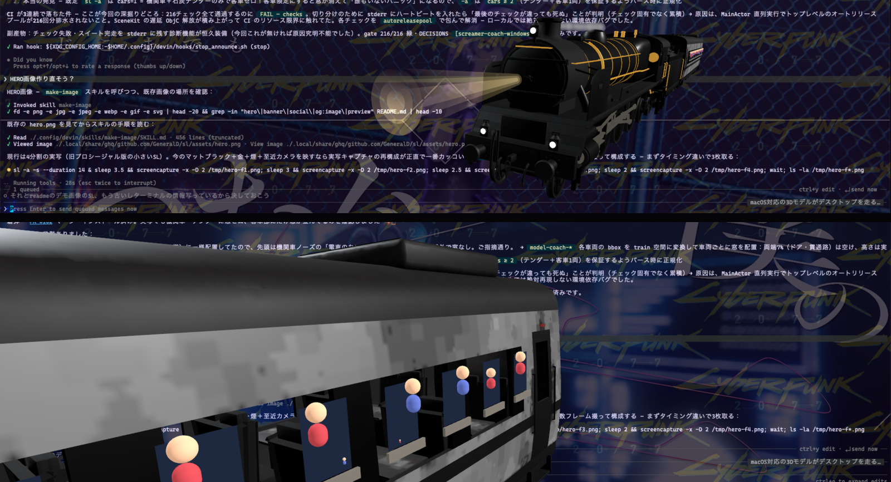
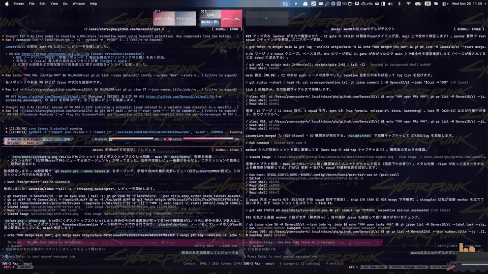

# sl

    



A `3D` steam locomotive that runs across your **actual desktop** — over
every open window, on every Space — when you typo `ls` into `sl`.

The original [`sl`](https://github.com/mtoyoda/sl) by Toyoda Masashi
punishes you inside the terminal. This one punishes you **everywhere**.

## Demo



Real captures, no mockups: `scripts/shot` freezes the run mid-frame and
writes a lane-cropped strip — either a verified screen capture or, with
`--render`, a deterministic offscreen render. More frames in
[`docs/shots/`](docs/shots/).

## Install

```sh
# homebrew (recommended)
brew install generald/tap/sl3d   # installs a binary still named `sl`

# or from source — needs only Command Line Tools, no Xcode
git clone https://github.com/GeneralD/sl && cd sl
make install                      # installs to /opt/homebrew (PREFIX=…)

# staged install — verify without touching the system
make install PREFIX=/usr/local DESTDIR=/tmp/sl-dest
/tmp/sl-dest/usr/local/bin/sl -v
man -M /tmp/sl-dest/usr/local/share/man sl
```

## Homebrew

`sl3d` ships via the [`GeneralD/tap`](https://github.com/GeneralD/tap) tap:

```sh
brew install GeneralD/tap/sl3d
```

The formula installs the `sl` binary and its man page; it declares
`conflicts_with "sl"` because the core `sl` formula owns that name.
The installed binary is still `sl` — flags and `man sl` are unchanged.

## Usage

```sh
sl          # a D51 crosses your desktop. you cannot stop it.
sl -e       # …unless you pass -e, then Ctrl+C works
sl -F       # Galaxy Express 999 — it flies away
sl -4       # locomotive + 4 cars
sl -l       # little train
sl -w       # windy: faster
sl -a       # screaming passengers
sl -c       # C51 instead of D51
sl -d       # disco mode
sl -s       # chuff & whistle (off by default)
sl --all    # traverse every connected display
sl --model engine.usdz   # your own USDZ/SCN/DAE locomotive
man sl
```

## Flags

| Flag | Effect |
|---|---|
| `-a` | An accident seems to happen. You feel pity for people who cry for help. |
| `-c` | A C51 locomotive appears instead of the D51. |
| `-d` | Disco mode. |
| `-e` | Allow interruption by Ctrl+C. Off by default, obviously. |
| `-F` | It flies like the Galaxy Express 999. |
| `-G` | A French TGV appears. |
| `-h`, `--help` | Print this flag table. |
| `-l` | A little version. |
| `-s` | Chuff and whistle. Silent by default. |
| `-v`, `--version` | Print version. |
| `-w` | Windy. It moves faster. |
| `-<n>` | Pull `n` trailing cars (1–10). |
| `--all` | Traverse every connected display. |
| `--model <file>` | Load a `.usdz`, `.scn` or `.dae` locomotive instead of the built-in one. |
| `--scale <f>` | Train size multiplier — the default already fills a large share of the screen height. |
| `--freeze <sec>` | Render one frozen frame and hold — the lane `scripts/shot` uses. |
| `--stealth` | Stay invisible: hidden from screenshots and screen recording. |

## How it works

`sl` is a bare Swift CLI that opens a borderless, transparent,
click-through `NSWindow` at `.screenSaver` level — above the Dock, the
menu bar, and fullscreen Spaces — renders a live SceneKit locomotive
into it, and deletes itself from existence when the train leaves the
screen. No permissions, no Dock icon, no focus stolen.

## Uninstall

```sh
make uninstall   # or: brew uninstall generald/tap/sl3d
```

## License

MIT — same as the original `sl`. You were warned.
