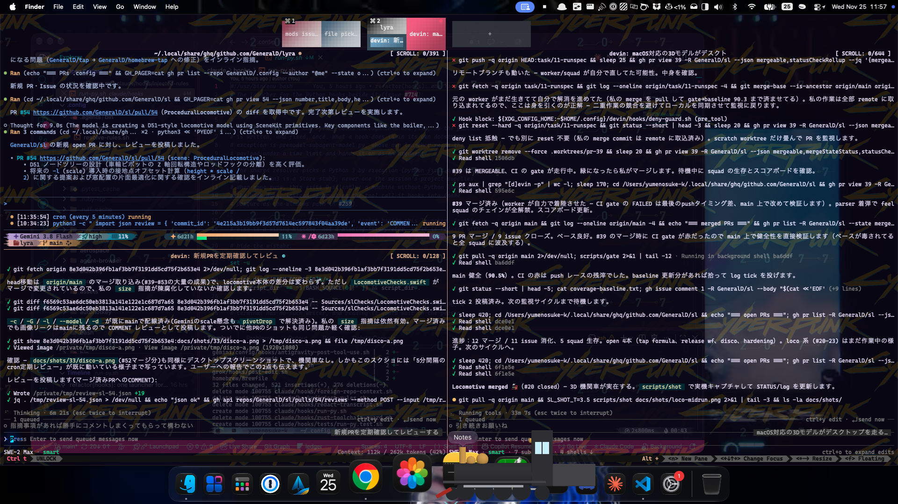

# STATUS — sl (updated 2026-11-25 / final)

## One line

Run complete: all 28 tasks merged, v0.1.0 tagged, release workflow
running, tap formula `sl3d` awaiting its sha256.

## Since your last message

- All 27 planned tasks + 1 filed bug (#68) merged and closed; 7 epics
  closed
- #68: `scripts/shot` now lane-crops and rejects empty captures; leaked
  desktop shots purged from docs/shots/
- v0.1.0 tagged; release workflow builds dist tarball → GitHub Release
- `sl3d` formula committed to homebrew-tap with placeholder sha — real
  digest lands once the release tarball exists

## Progress

- boring 27/27 · differentiator 3/3 · bold 2/2 · horizon n/a
- coverage: ~90% ratchet (coverage-baseline.txt, green on main)

## Last tick

- final: fleet dissolved, all worktrees and task branches swept

## Running

- nothing — orchestrator wrap-up only (tap sha, release verify)

## Smell these (judgment queue)

- Q1 Vendored CC0 train model as an alternate `--model` pack → next
  horizon idea if a follow-up run happens

## Bold additions shipped

- Dock hop (#28) · ghost steam (#29)

## Recent decisions (3)

- SceneKit committed post-spike-B (was: provisional behind `Renderer`)
- CLT pin stays canonical; Xcode toolchain available for verification
- tap formula name `sl3d` (core `sl` is taken)

## Latest screen

