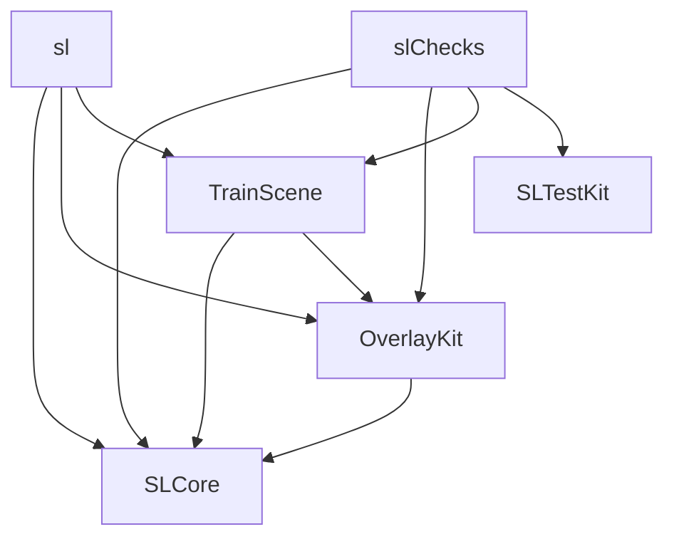

# Architecture

Generated by `scripts/arch-graph` — do not edit by hand.

## Targets

| Target | Kind | Depends on |
|---|---|---|
| `OverlayKit` | regular | SLCore |
| `SLCore` | regular | — |
| `SLTestKit` | regular | — |
| `TrainScene` | regular | SLCore, OverlayKit |
| `sl` | executable | SLCore, OverlayKit, TrainScene |
| `slChecks` | executable | SLCore, OverlayKit, TrainScene, SLTestKit |

## Dependency graph

